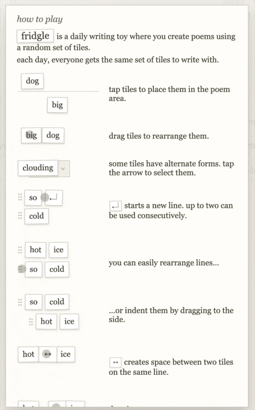

import Layout from "~/src/components/ArticleLayout";

export default Layout;
export const metadata = {
	title: "Fridgle is what the internet should be",
	description: "An ode to my new favorite website.",
	date: "2026-11-11",
	bskyPostId: "3n23am77y3c2s",
	tags: ["web-dev", "essay"],
};

[Fridgle.net](https://fridgle.net) is my new favorite website.
Fridgle is a daily word game created by [Ian Sly](https://ivysly.com) that is inspired by the popular fridge word magnets.
Each day the game has a new random list of words on your “fridge” that you can use to write a poem.

<figure></figure>

Composing a good poem in fridgle can be difficult, but the game is flexible enough that it’s not too challenging.
You’re allowed to change the tense of verbs and the pluralization of nouns, which offers enough flexibility for whatever your goal is.
Usually I try to write a funny poem, and although there’s no word limit, I find shorter poems to be the most satisfying.

There’s a social component of fridgle too.
After finalizing your poem, you can browse the “world fridge,” a random ordering of other users’ poems.
You can optionally attach your name to the poem, but the vast majority I see are either anonymous or use the name as a free-text addendum to the poem.

There is no upvoting, ranking, or commenting on poems in the world fridge. The site’s design also spaces out each poem vertically so only one is visible at a time.
The minimalist and mainly anonymous design makes playing fridgle feel socially connected, but not exhausting or inflammatory in the way that most of the social internet feels.

Playing fridgle and browsing the world fridge has become a daily habit for me.
Every day I browse the world fridge I find some poems that are hilarious or genuinely creative.
Because all of the poems each day share the same set of words, there’s often certain phrases or themes that the day’s poems gravitate too. 
It’s particularly fun to find a poem that either nails that theme, or one that zags into an entirely different and unexpected direction.

And because the poems on the fridge appear in a random order, finding a good one among the average ones feels like making a genuine discovery. 
It’s like finding the perfect piece of clothing at a thrift store or a great deal at a yard sale.

Fridgle is everything I think the internet should be.
The game brings out people’s inherent creativity and shares it with the world.
And it does so in a way that is intentionally designed not to platform vitriol or mine its users' attention.
I hope it inspires other social games and spaces like it on the internet.